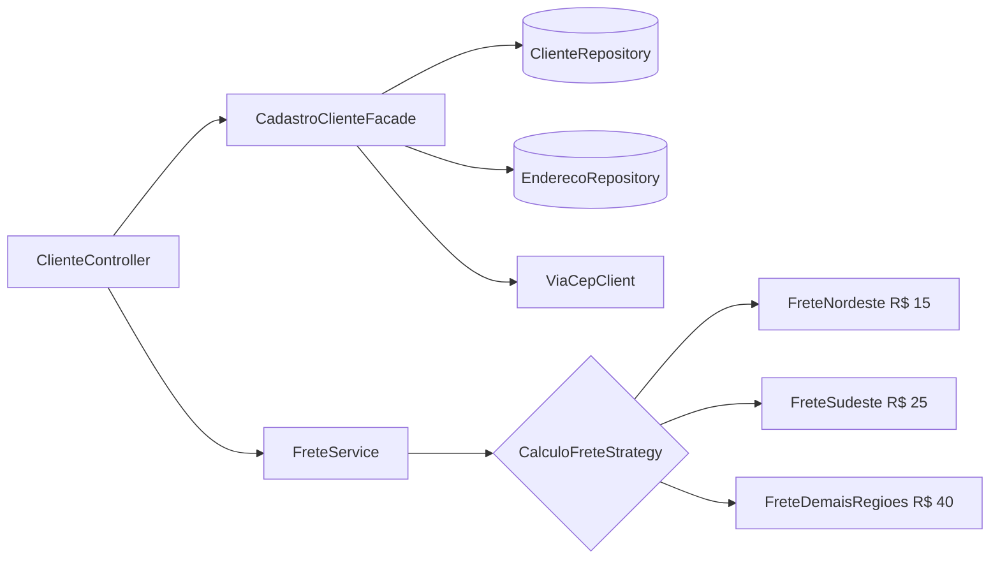

# Padrões de Projeto na Prática com Java e Spring

Projeto do desafio **"Explorando Padrões de Projetos na Prática com Java"** (DIO). É uma API REST de cadastro de clientes que consulta o endereço pelo CEP (ViaCEP) e calcula o frete por região. Usa os padrões **Singleton**, **Strategy** e **Facade**.

> Base: repositório do lab da DIO (`lab-padroes-projeto-spring`). Esta versão corrige bugs do original, moderniza as versões e acrescenta um Strategy de verdade.

## Padrões aplicados

| Padrão | Onde está | Problema que resolve |
|---|---|---|
| **Singleton** | Todo `@Service`/`@Component` (ex.: `CadastroClienteFacade`, `FreteService`) | O Spring cria **uma única instância** de cada bean e a injeta onde for preciso. Prova no teste `SingletonBeanTest`. |
| **Strategy** | `CalculoFreteStrategy` + `FreteNordeste`, `FreteSudeste`, `FreteDemaisRegioes`, escolhidas pelo `FreteService` | Evita um `if/else` gigante para o frete. Nova regra = nova classe `@Component`, sem mexer no código existente. |
| **Facade** | `CadastroClienteFacade` | Esconde a coordenação entre `ClienteRepository`, `EnderecoRepository` e `ViaCepClient` atrás de métodos simples (`criar`, `atualizar`...). O controller não conhece o ViaCEP. |



Os valores de frete são fictícios, só para demonstrar o padrão.

## Como rodar

Requisitos: **Java 17+** e **Maven 3.9+** (ou abra no IntelliJ/VS Code/Eclipse).

```bash
mvn spring-boot:run
```

- Swagger: http://localhost:8080/swagger-ui.html
- Console H2: http://localhost:8080/h2-console (JDBC URL exibida no log de inicialização)

## Endpoints

| Método | Rota | Descrição |
|---|---|---|
| GET | `/clientes` | Lista clientes |
| GET | `/clientes/{id}` | Busca por id (404 se não existir) |
| POST | `/clientes` | Cria cliente (consulta o CEP no ViaCEP) |
| PUT | `/clientes/{id}` | Atualiza cliente existente |
| DELETE | `/clientes/{id}` | Remove (204) |
| GET | `/clientes/{id}/frete` | Calcula frete com a Strategy da UF |

Exemplo:

```bash
curl -X POST http://localhost:8080/clientes \
  -H "Content-Type: application/json" \
  -d '{"nome":"Kauan","cep":"64000-000"}'
```

```json
{
  "id": 1,
  "nome": "Kauan",
  "endereco": { "cep": "64000000", "logradouro": "...", "bairro": "...", "localidade": "Teresina", "uf": "PI" }
}
```

```bash
curl http://localhost:8080/clientes/1/frete
# {"clienteId":1,"uf":"PI","estrategia":"NORDESTE","valor":15.00}
```

Erros seguem o padrão RFC 7807 (`ProblemDetail`): 400 (validação), 404 (cliente), 422 (CEP inexistente) e 502 (ViaCEP fora do ar).

## Como adicionar uma nova regra de frete

Crie uma classe que implemente `CalculoFreteStrategy`, anote com `@Component` e `@Order(n)` (menor número = avaliada primeiro). Nenhuma outra classe precisa mudar.

## Testes

```bash
mvn test
```

- `CadastroClienteFacadeTest`: Mockito, cobre CEP novo, CEP salvo, CEP inexistente, atualização e 404.
- `FreteServiceTest`: escolha da Strategy por UF.
- `ClienteControllerTest`: validação e status HTTP com MockMvc.
- `SingletonBeanTest`: mesma instância do bean.

## O que mudou em relação ao lab original

- Spring Boot 2.5 / Java 11 → **Spring Boot 3.5 / Java 17** (`jakarta.persistence`).
- `buscarPorId` com `Optional.get()` (erro 500) → **404 tratado**.
- `atualizar` criava um cliente novo (faltava o id) → **atualiza o registro existente**.
- CEP inexistente (`{"erro": true}`) gerava endereço inválido → **422 com mensagem clara**.
- Injeção por campo (`@Autowired`) → **injeção por construtor**.
- Entidades expostas na API → **DTOs** com validação (`@Valid`).
- "Strategy" que era só interface + 1 implementação → **Strategy real** (frete por região).
- Testes: de só `contextLoads` para testes de unidade, controller e Singleton.
